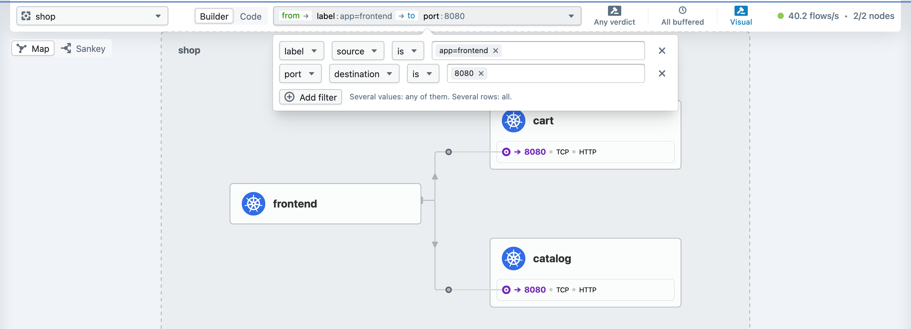
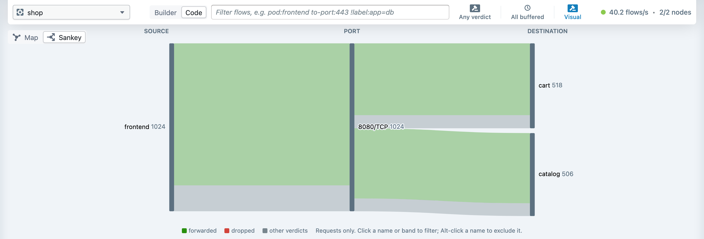
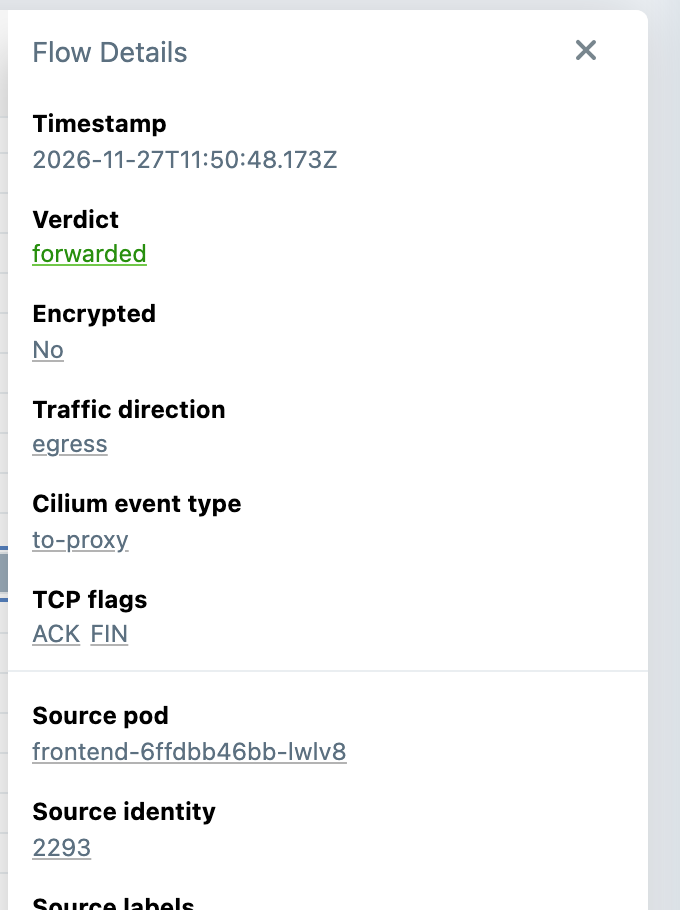

<h1 align="center">Hubble UI</h1>
<p align="center">
  Hubble UI is an open-source user interface for <a href="https://github.com/cilium/hubble">Cilium Hubble</a>.
</p>

This is tellbow's fork of [cilium/hubble-ui](https://github.com/cilium/hubble-ui),
maintained on its own: it builds, tests and publishes its images here, and takes
fixes from upstream as backports (see [Upstream](#-upstream)).

## ✨ What this fork adds

**Finding flows**
- A filter language with the flags of `hubble observe` (`from-pod:frontend
  to-port:443 !label:app=db`), checked as you type, kept in the URL
  ([Filtering flows](#filtering-flows)).
- A **Builder** mode that edits the same filters as rows, suggesting the values
  seen on screen.
- Click a value in the flow details (verdict, encrypted, direction, event type,
  port, pod, label, IP, DNS, …) to add or remove a filter for it.
- A **Sankey** view of who talks to whom on which port, next to the service map.

**Seeing more**
- A welcome screen that lists namespaces by their traffic; "All namespaces"
  with a box per namespace.
- The policies that allowed or denied a flow, its encryption status, and why a
  red arrow drops (click it for the dropped flows).
- One world card per identity, titled by its label.
- A time range, pause, CSV and Hubble JSON export, dark mode, phone-width layouts.

**Holding up**
- Streams that no longer get stuck, lose messages or leak, found by fault
  injection; the UI reopens them after a backend restart.
- Errors reach the screen: a filter Cilium rejects is reported once instead of
  reconnecting forever.
- Limits on open streams and request size; CORS from loopback only.
- Playwright tests in a real browser, and the filters golden-tested against
  Cilium's own filter code.

| Filter builder | Sankey view | Flow details |
| :-: | :-: | :-: |
|  |  |  |

## 🚀 Installation

Hubble UI is installed as part of Hubble. Please see the Hubble [Getting Started Guide](https://docs.cilium.io/en/stable/gettingstarted/hubble/#deploy-cilium-and-hubble) for instructions.

To run this fork's images, point Cilium's Helm chart at them:

```yaml
hubble:
  ui:
    enabled: true
    frontend:
      image:
        override: ghcr.io/tellbow/hubble-ui:<tag>
    backend:
      image:
        override: ghcr.io/tellbow/hubble-ui-backend:<tag>
```

Every push to `main` also publishes `ghcr.io/tellbow/hubble-ui-ci` and
`ghcr.io/tellbow/hubble-ui-backend-ci`, tagged `latest` and with the commit SHA.

### Compatibility

The namespace overview on the welcome screen asks hubble-relay for its newest
10,000 flows once per page load (page loads within 30 s share one answer). It
asks only for four fields of each flow with `GetFlowsRequest.field_mask`, which
Cilium 1.16 added. A relay from Cilium 1.15 or older ignores the mask and sends
whole flows: the counts stay right, but each answer is far larger (about 1–2 KB
per flow instead of under 100 bytes).

### Filtering flows

The filter input takes the flags of `hubble observe`, written `field:value`
and separated by spaces:

```
from-pod:frontend to-port:443,8443 !to-fqdn:*.example.com http-method:POST
```

- `from-` / `to-` pick the source or destination; without one, either matches.
- Different fields must all match (AND); comma-separated values of one field
  are alternatives (OR); `!` leaves out what matches.
- Fields: `label`, `pod` (`namespace/name`), `workload` (`Kind:name`),
  `identity`, `ip` (address or CIDR), `fqdn` (`*` wildcards), `port`,
  `protocol`, `http-method`, `http-path` (regular expression), `node-name`,
  `tcp-flags`, `encrypted` (`yes`/`no`), `traffic-direction`
  (`ingress`/`egress`), `event-type` (`to-proxy`, `to-endpoint`, …),
  `drop-reason` (`policy-denied`, …).

The filters are kept in the URL (`?filter=…`), so a link shows the same view.
**Builder** mode edits the same filters as rows of field, operator and values,
suggesting the values seen on screen. In the flow details, a value such as
Encrypted, Traffic direction or Destination port toggles a filter for it.

Hubble leaves the pod name out of some flows (packets delivered after the L7
proxy), so a `pod:` filter misses them; `label:app=…` catches them.

### Sankey view

Next to the service map, **Sankey** shows the requests as bands from source
through port to destination, as wide as their flow count and coloured by
verdict. Click a name to filter for it, Alt-click to filter it out.

## 🌐 Why Hubble UI?

Troubleshooting microservices application connectivity is a challenging task. Simply looking at `kubectl get pods` does not indicate dependencies between each service, external APIs, or databases.

Hubble UI enables zero-effort automatic discovery of the service dependency graph for Kubernetes Clusters at L3/L4 and even L7, allowing user-friendly visualization and filtering of those dataflows as a Service Map.

See [Hubble Getting Started Guide](https://docs.cilium.io/en/stable/gettingstarted/hubble/#deploy-cilium-and-hubble) for details.


## 🌏 Releases

Push a tag `vX.Y.Z` (or `vX.Y.Z-rcN`). The [Image Release Build](.github/workflows/images-releases.yaml)
workflow builds both images for amd64 and arm64 and pushes them to
`ghcr.io/tellbow/hubble-ui` and `ghcr.io/tellbow/hubble-ui-backend` with the
repository's `GITHUB_TOKEN`; no other account or secret is involved.

## 🧪 Tests

```sh
npm test                                    # frontend unit tests (jest)
(cd backend && go test -mod=vendor ./...)   # backend unit tests
npx playwright install chromium             # once
npm run test:e2e                            # Playwright, in a real browser
```

The Playwright tests need no cluster: they start the backend in its e2e mode,
which serves the flows of `e2e/fixtures/demo`, and the production build behind
`e2e/serve.mjs`, which proxies `/api` as nginx does.

## 🔁 Upstream

The fork keeps upstream's layout and the Go module path
`github.com/cilium/hubble-ui/backend` on purpose, so that upstream commits apply
without rewriting imports. To backport one:

```sh
git remote add upstream https://github.com/cilium/hubble-ui.git  # once
git fetch upstream
git switch -c backport/<topic> main
git cherry-pick -x <upstream-sha>   # -x records the upstream commit in the message
```

Open a pull request against `main` as for any change.

## ⚖️ License

[Apache License, Version 2.0](LICENSE)
